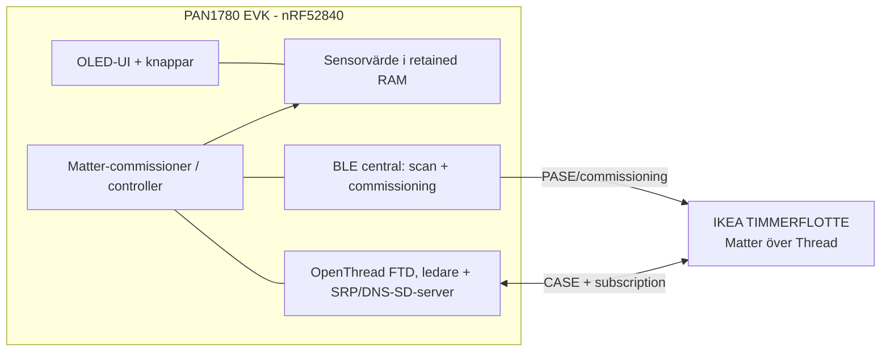

# Arkitektur

Beskriver vad som är implementerat i Matter-bygget
([firmware/matter_proto](../firmware/matter_proto)).

## Flöde

1. Vid start skapas ett Thread-dataset och PAN1780 blir Thread-ledare. Den kör
   också SRP- och DNS-SD-server, så ingen border router behövs.
2. Matter-stacken startas som commissioner med en egen fabric (nod `0x1000`).
3. Flotte hittas via BLE (`ble_scan.cpp`, `ble_central.cpp`) och commissioneras
   med en manuell parningskod, eller med den kod som sparats på enhetsplats 1
   om CASE inte lyckas.
4. Därefter ansluts Flotte (nod `0x2001`) med CASE och controllern prenumererar på
   - temperatur: endpoint 1, kluster `0x0402`, enhet 0,01 °C
   - luftfuktighet: endpoint 2, kluster `0x0405`, enhet 0,01 %
5. Varje rapport loggas på UART med tidsstämpel, uppdaterar senaste värdet
   (`devices.cpp`) och visas på OLED i mode 4.

## Beteenden som är uppmätta

- Flotte rapporterar bara vid ändrat värde och vaknar ungefär varje minut.
  Per sensor kom det en rapport ca var 2:a–6:e minut (längsta glapp 397 s under
  12 timmar).
- Flotte skickar ingen keepalive när värdet är oförändrat. Prenumerationen
  (begärd max 900 s, accepterad max 300 s) får därför `Liveness timeout` ungefär
  var 5:e–9:e minut och förnyas automatiskt med CASE-återupptagning inom ca 9 s.
  Under 12 timmar lyckades alla förnyelser.
- Stale-gränsen för visningen är 15 minuter.

## Lagring

- Alarm, standardläge och enhetskoder ligger i flash (Zephyr settings/NVS).
- Matter-stackens egna data ligger i samma `storage_partition`.
- Senaste temperatur och luftfuktighet med tidsstämpel ligger enbart i retained
  RAM (inte i flash, för att undvika slitage). De överlever reset men inte
  strömavbrott.

## Anpassningar av Matter-modulen

`matter_proto/patches/matter-controller.patch` innehåller de ändringar som
behövs i `modules/lib/matter` (controller-fabrik, PSA SPAKE2+, BLE-manager).
Patchen appliceras inte automatiskt: efter `west update` körs
`git -C modules/lib/matter apply ../../../matter_proto/patches/matter-controller.patch`
från `firmware/`.

## Kända begränsningar

- Attestation godkänns utan verifiering (`IgnoreAttestation` i `controller.cpp`).
- Controllern använder en tillfällig lösning (`InjectResolve`) för att hitta
  Flotte via SRP-registreringen, eftersom Flotte inte publicerar `_matter._tcp`
  före CommissioningComplete. Den körs i ca 5 minuter efter start.
- Bygget är utan bootloader och med testcertifikat och testpin (`20202021`).
- Flashmarginalen i Matter-bygget är ca 56 KiB (90,9 % av 1 MB).
